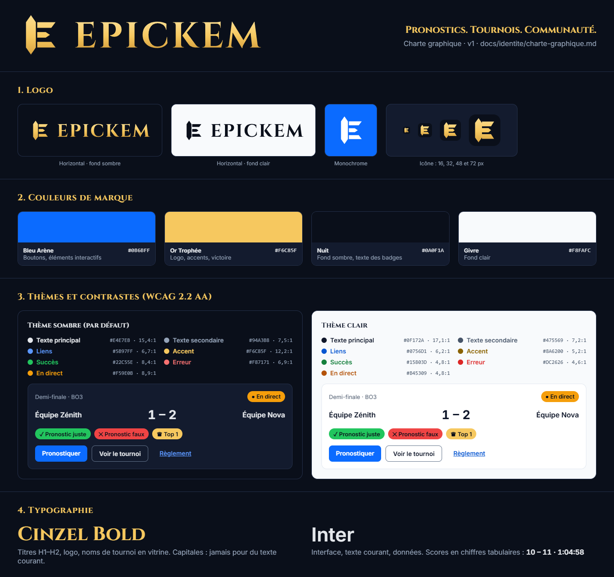

# Charte graphique Epickem

> Version 1. Les valeurs de cette charte sont définies dans le code, dans
> [`packages/shared/src/theme.ts`](../../packages/shared/src/theme.ts). `pnpm test` vérifie leurs
> contrastes à chaque commit. Si vous changez une couleur, changez-la là-bas, puis mettez cette page à jour.



## 1. Nom

- Dans un texte, on écrit **Epickem**. Dans le logo et les titres en Cinzel, le nom s'affiche en capitales : **EPICKEM**. On n'écrit pas « EPICKEM » en dur dans un texte : un lecteur d'écran risquerait de l'épeler lettre par lettre.
- Accroche : **Pronostics. Tournois. Communauté.** (constante `APP_TAGLINE`).
- Le nom et l'accroche viennent de `@epickem/shared` (`APP_NAME`, `APP_TAGLINE`). Ne les recopiez pas.

## 2. Logo

Le symbole est un « E » : un fût taillé en pointe aux deux bouts, une barre en haut, une en bas, et une **flèche au centre**, qui représente le pronostic. À côté, le logotype EPICKEM est écrit en Cinzel Bold et vectorisé, ce qui le rend indépendant de la police installée.

| Fichier (`docs/identite/logo/`)                                  | Usage                                                           |
| ---------------------------------------------------------------- | --------------------------------------------------------------- |
| `logo-horizontal.svg`                                            | Version principale, dorée, **sur fond sombre**                  |
| `logo-horizontal-sombre.svg`                                     | Sur fond clair (couleur Nuit)                                   |
| `logo-horizontal-blanc.svg`                                      | Monochrome, sur photo ou fond coloré                            |
| `symbole.svg`, `symbole-sombre.svg`, `symbole-blanc.svg`         | Symbole seul : avatar, coin d'écran, filigrane                  |
| `icone.svg`                                                      | Icône (symbole simplifié sur carré Nuit) : favicon, onglet      |
| `icone-pleine.svg`                                               | Même icône sans coins arrondis (le système applique son masque) |
| `icone-android-premier-plan.svg`, `icone-android-monochrome.svg` | Icône adaptative Android et icône à thème (Android 13+)         |
| `*.png`                                                          | Exports prêts à l'emploi (présentations, README)                |

Les tracés existent aussi dans le code (`LOGO_SYMBOL`, `LOGO_HORIZONTAL` dans `@epickem/shared`). Sur le web, le composant `Logo` (`apps/web/app/logo.tsx`) les utilise et suit le thème : doré en sombre, Nuit en clair.

**Règles**

- **Zone de protection** : autour du logo, laissez un espace vide d'au moins un quart de la hauteur du symbole.
- **Tailles minimales** : logo horizontal, 24 px de haut ; symbole, 24 px. En dessous, jusqu'à 16 px, utilisez `icone.svg` : son symbole est simplifié, avec des barres plus épaisses et soudées au fût, pour rester lisible.
- **À ne pas faire** : déformer, pivoter, changer les couleurs hors des variantes ci-dessus, ajouter une ombre ou un contour, poser le logo doré sur un fond clair (contraste 1,5:1).

## 3. Couleurs

### Couleurs de marque

| Nom            | Valeur    | Usage                                         |
| -------------- | --------- | --------------------------------------------- |
| **Bleu Arène** | `#0B6BFF` | Bouton principal, éléments interactifs        |
| **Or Trophée** | `#F6C85F` | Logo, accents, mise en avant (rang, victoire) |
| **Nuit**       | `#0A0F1A` | Fond sombre, texte des badges                 |
| **Givre**      | `#F8FAFC` | Fond clair                                    |

### Couleurs à rôle (thèmes sombre et clair)

Un composant utilise toujours un **rôle**, jamais une valeur brute. Sur le web, ce sont les variables `var(--epk-…)` ; sur le mobile, `themes.dark` et `themes.light`. Le thème **sombre** est celui par défaut. Le thème clair s'applique quand le système le demande. Sur le web, `data-theme="light"` ou `"dark"` sur `<html>` force l'un ou l'autre.

| Rôle             | Clé         | Sombre    | Contraste min. | Clair     | Contraste min. |
| ---------------- | ----------- | --------- | -------------- | --------- | -------------- |
| Texte principal  | `text`      | `#E4E7EB` | 12,1:1         | `#0F172A` | 17,1:1         |
| Texte secondaire | `textMuted` | `#94A3B8` | 5,8:1          | `#475569` | 7,2:1          |
| Liens, focus     | `link`      | `#5B97FF` | 5,2:1          | `#0756D1` | 6,2:1          |
| Accent (doré)    | `accent`    | `#F6C85F` | 9,5:1          | `#8A6200` | 5,2:1          |
| Succès           | `success`   | `#22C55E` | 6,6:1          | `#15803D` | 4,8:1          |
| Erreur           | `error`     | `#F87171` | 5,4:1          | `#DC2626` | 4,6:1          |
| En direct        | `live`      | `#F59E0B` | 7,0:1          | `#B45309` | 4,8:1          |

Le contraste minimum est le plus faible des trois fonds possibles : `background`, `surface` (cartes) et `surfaceRaised`. En sombre, ces fonds valent `#0A0F1A`, `#131B2E` et `#1C2640` ; en clair, `#F8FAFC`, `#FFFFFF` et `#FFFFFF`.

D'autres rôles complètent le tableau :

- `border` : `#64748B`, bordure des champs et contrôles, au moins 3:1 ;
- `divider` : séparateurs décoratifs ;
- **bouton principal** : fond Bleu Arène, texte blanc (4,6:1), survol `#0A5FE0` (5,6:1) ;
- **badges** : fonds pleins `#22C55E`, `#EF4444`, `#F59E0B` et Or Trophée, avec **toujours du texte Nuit** (de 5,1 à 12,2:1). Du texte blanc sur un badge vert ou rouge ne passe pas (2,3:1 et 3,8:1).

**Règles d'accessibilité** (WCAG 2.2 AA, [ADR-0011](../adr/0011-accessibilite-outillage.md))

- **Seuils** : 4,5:1 pour le texte, 3:1 pour les contrôles et le texte de 24 px et plus. Tous les couples autorisés sont listés dans `contrastRules` et testés.
- **Jamais la couleur seule** : un statut a toujours une icône et un libellé (« ✓ Pronostic juste », « ● En direct »).
- **Pas de doré en texte sur fond clair** : en thème clair, le texte d'accent est `#8A6200`. L'or vif reste réservé aux fonds de badge et au logo sur fond sombre.
- **Focus visible** partout : un contour de 3 px de la couleur `focus`.

## 4. Typographie

| Police                                                      | Usage                                                                        | Graisses      |
| ----------------------------------------------------------- | ---------------------------------------------------------------------------- | ------------- |
| **Cinzel** ([OFL](../../apps/web/app/fonts/OFL-Cinzel.txt)) | Logo, titres H1–H2, noms de tournoi en vitrine                               | 700           |
| **Inter** ([OFL](../../apps/web/app/fonts/OFL-Inter.txt))   | Tout le reste : interface, texte courant, formulaires, **scores et données** | 400, 600, 700 |

- Cinzel n'a que des capitales : elle ne convient pas au texte courant, ni aux chiffres d'un score.
- Les scores, classements et chronos utilisent des **chiffres tabulaires** (`font-variant-numeric: tabular-nums`, classe `.tabular`), pour qu'un score qui change ne fasse pas bouger la mise en page.
- Les tailles sont en `rem`, avec 16 px minimum pour le texte courant. L'échelle est définie dans `fontSizes`.
- Sur le web, les polices sont **hébergées dans le dépôt** (`apps/web/app/fonts/`, chargées par `next/font/local`). Il n'y a aucun appel à Google Fonts, ni pendant le build, ni chez le visiteur.

## 5. Formes et espacements

- **Rayons** : 6 px (badge carré, champ), 8 px (bouton), 12 px (carte), complet (pastille).
- **Espacements** : grille de 4 px (4, 8, 12, 16, 24, 32, 48), définie dans `spacing`.
- **Icônes** : un seul style, au trait, avec des coins arrondis. Elles sont toujours accompagnées d'un libellé, visible ou `aria-label`.
- **Mouvement** : les animations sont désactivées si l'utilisateur a choisi « réduire les animations » (`prefers-reduced-motion`).

## 6. Utilisation dans le code

```tsx
// Web : variables CSS (injectées par apps/web/app/layout.tsx)
<p style={{ color: 'var(--epk-text-muted)' }}>…</p>;

// Mobile : objet de thème
import { themes } from '@epickem/shared';
const colors = themes[useColorScheme() === 'light' ? 'light' : 'dark'];
<Text style={{ color: colors.textMuted }}>…</Text>;
```

Quand Tailwind CSS sera installé ([ADR-0002](../adr/0002-frontend-web-nextjs.md)), il suffira de déclarer les rôles dans le thème. Les classes `bg-surface` ou `text-muted` suivront alors automatiquement le thème clair ou sombre :

```css
@import 'tailwindcss';
@theme inline {
  --color-background: var(--epk-background);
  --color-surface: var(--epk-surface);
  --color-text: var(--epk-text);
  --color-muted: var(--epk-text-muted);
  --color-link: var(--epk-link);
  --color-accent: var(--epk-accent);
  --color-primary: var(--epk-primary);
  --color-success: var(--epk-success);
  --color-error: var(--epk-error);
  --color-live: var(--epk-live);
  --font-display: var(--epk-font-display);
  --font-sans: var(--epk-font-body);
}
```

## 7. Originalité

- Le logo a été dessiné pour le projet : ce sont des formes géométriques simples, et le logotype est composé en Cinzel, une police sous licence OFL qui autorise cet usage. Il ne reprend aucun élément d'une marque existante.
- L'identité ne fait **aucune référence** à un éditeur de jeu, à un univers de jeu ou à une plateforme existante : pas de nom, de décor, de personnage ni de motif emprunté. Les noms de jeux n'apparaissent que comme des **données** (le jeu d'un tournoi), jamais dans l'identité.
- Les visuels d'illustration (bannières, fonds) doivent rester abstraits ou être créés par l'équipe.
