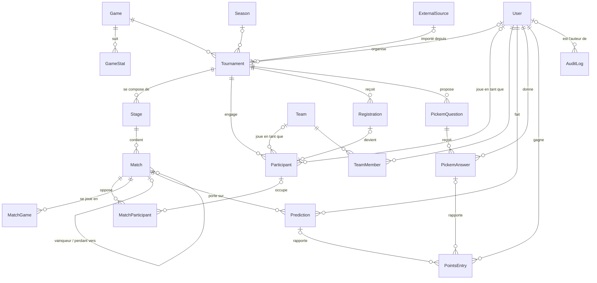

# Modèle de données

Ce document décrit le modèle de données de la plateforme, version 1. Le schéma de référence est
[`apps/api/prisma/schema.prisma`](../../apps/api/prisma/schema.prisma) : en cas de doute, c'est lui qui fait foi.
Les choix techniques sont justifiés dans l'[ADR-0004](../adr/0004-base-de-donnees-postgresql-prisma.md)
(PostgreSQL et Prisma) et l'[ADR-0009](../adr/0009-recalcul-en-cascade-et-audit.md) (historique et audit).

## Correspondance avec le sujet

Le sujet (bloc 03-C) liste 14 entités. Le code est en anglais, d'où les noms ci-dessous.

| Entité du sujet | Modèle(s)                   | Remarque                                                                     |
| --------------- | --------------------------- | ---------------------------------------------------------------------------- |
| Jeu             | `Game`                      |                                                                              |
| Statistique     | `GameStat`                  | statistiques suivies pour un jeu ; leurs valeurs sont dans `MatchGame.stats` |
| Tournoi         | `Tournament`, `Season`      | la saison sert aux classements par saison                                    |
| Étape           | `Stage`                     | format et réglages (BO, départage, qualification…)                           |
| Match           | `Match`, `MatchParticipant` | un match a 2 participants (duel) ou plus (FFA)                               |
| Manche          | `MatchGame`                 | une game d'un BO3, une carte…                                                |
| Équipe          | `Team`, `TeamMember`        |                                                                              |
| Joueur          | `User`, `Participant`       | `User` = compte ; `Participant` = joueur ou équipe engagé dans un tournoi    |
| Inscription     | `Registration`              | statut, liste d'attente, check-in, champs personnalisés                      |
| Pronostic       | `Prediction`                | match par match ou arbre complet                                             |
| Question        | `PickemQuestion`            |                                                                              |
| Réponse         | `PickemAnswer`              |                                                                              |
| Classement      | `PointsEntry`               | les classements sont calculés à partir des points (voir plus bas)            |
| Source          | `ExternalSource`            | tournoi importé (start.gg ou autre connecteur)                               |

S'ajoute `AuditLog`, le journal des actions sensibles exigé par le bloc 03-B.

## Vue d'ensemble



## Choix de conception

**Compte et participant sont distincts.** Un joueur d'un tournoi importé de start.gg n'a pas de compte chez nous.
`Participant` représente donc un joueur ou une équipe _dans un tournoi_ et pointe éventuellement vers un `User` ou une `Team`.

**Un match a un nombre quelconque de participants.** `MatchParticipant` porte le score, le classement et les points de
placement. La même structure sert aux duels et au FFA. Une place peut être vide tant que le qualifié n'est pas connu, ou
marquée comme exempt (`isBye`).

**L'arbre est un graphe de matchs.** `winnerNextMatchId` et `loserNextMatchId` indiquent où vont le vainqueur et le perdant
(double élimination). Les autres formats n'utilisent que `round`, `position` et `groupLabel`. La génération et la
cohérence des arbres relèvent du moteur de tournois ([ADR-0008](../adr/0008-moteur-de-tournois-strategy.md)).

**Les données qui varient sont en JSONB**, et validées par des schémas Zod côté API :
`Stage.settings` (réglages d'étape), `Tournament.customFields` et `Registration.customFieldValues` (champs d'inscription),
`Tournament.scoring` (barème), `MatchGame.stats` (statistiques de manche), `PickemQuestion.config`, `choices` et `resolution`.

**Les classements sont calculés, pas stockés.** Chaque point gagné est une ligne de `PointsEntry`. Le classement d'un tournoi,
d'une saison ou le classement général est la somme des entrées actives (`supersededAt` vide). Lors d'un recalcul en cascade,
on ne modifie jamais une entrée : on la marque remplacée et on en crée une nouvelle, ce qui conserve l'historique
(ADR-0009). Si le calcul devient trop lent, Redis servira de cache (ADR-0006).

**Verrouillage des pronostics.** `Match.predictionsLockAt` (et `Stage.bracketLockAt` pour l'arbre complet) est comparé à
l'horloge du serveur : l'API refuse tout pronostic après cette date.

**Tournois importés.** Un tournoi avec une `ExternalSource` est en lecture seule. Les identifiants de la source sont gardés
dans `externalId` (participants, matchs) pour les synchronisations.

**Conventions.** Identifiants UUID, dates en UTC (`timestamptz`), tables et colonnes en `snake_case`.
Supprimer un tournoi supprime ses étapes, matchs, inscriptions et pronostics ; supprimer un compte ne supprime pas les
tournois qu'il a organisés.

### Hors de la v1

Prévu dans les milestones suivants, par de nouvelles migrations : groupes privés et badges (02-G), litiges et preuves (02-C),
notifications (02-I).

## Faire évoluer le schéma

Depuis `apps/api`, avec PostgreSQL lancé (`docker compose up -d postgres`) et un `.env` à la racine :

```bash
pnpm db:migrate --name description-courte   # crée et applique une migration (à commiter)
pnpm db:generate                             # régénère le client Prisma (fait aussi par build et typecheck)
pnpm db:studio                               # explore la base dans le navigateur
```

Dans Docker, l'API applique les migrations en attente à chaque démarrage (`prisma migrate deploy`).
Pensez à mettre à jour ce document dans la même PR que la migration.

## Dictionnaire des données

### User — table `users`

Compte de la plateforme (administrateur, joueur ou spectateur).

| Champ          | Type        | Contraintes                   | Description                    |
| -------------- | ----------- | ----------------------------- | ------------------------------ |
| `id`           | `String`    | clé primaire, défaut `uuid()` | Identifiant.                   |
| `email`        | `String`    | unique                        |                                |
| `displayName`  | `String`    |                               |                                |
| `passwordHash` | `String`    |                               |                                |
| `role`         | enum `Role` | défaut `SPECTATOR`            |                                |
| `createdAt`    | `DateTime`  | défaut `now()`                | Date de création.              |
| `updatedAt`    | `DateTime`  | mis à jour automatiquement    | Date de dernière modification. |

### Game — table `games`

Jeu (ou sport) sur lequel portent les tournois.

| Champ       | Type       | Contraintes                   | Description                    |
| ----------- | ---------- | ----------------------------- | ------------------------------ |
| `id`        | `String`   | clé primaire, défaut `uuid()` | Identifiant.                   |
| `name`      | `String`   |                               |                                |
| `slug`      | `String`   | unique                        |                                |
| `createdAt` | `DateTime` | défaut `now()`                | Date de création.              |
| `updatedAt` | `DateTime` | mis à jour automatiquement    | Date de dernière modification. |

### GameStat — table `game_stats`

Statistique relevée à chaque manche pour un jeu donné.

| Champ     | Type             | Contraintes                   | Description                                                      |
| --------- | ---------------- | ----------------------------- | ---------------------------------------------------------------- |
| `id`      | `String`         | clé primaire, défaut `uuid()` | Identifiant.                                                     |
| `gameId`  | `String`         | → `Game`                      |                                                                  |
| `key`     | `String`         |                               | identifiant stable utilisé dans les JSON de manche (ex. "kills") |
| `label`   | `String`         |                               |                                                                  |
| `type`    | enum `StatType`  |                               |                                                                  |
| `scope`   | enum `StatScope` | défaut `PARTICIPANT`          |                                                                  |
| `options` | `String[]`       |                               | Valeurs possibles pour le type CHOICE (personnages, cartes…).    |
| `unit`    | `String`         | facultatif                    |                                                                  |

Unicité : `(gameId, key)`.

### Season — table `seasons`

Saison regroupant des tournois, pour les classements par saison.

| Champ      | Type       | Contraintes                   | Description  |
| ---------- | ---------- | ----------------------------- | ------------ |
| `id`       | `String`   | clé primaire, défaut `uuid()` | Identifiant. |
| `name`     | `String`   |                               |              |
| `startsAt` | `DateTime` |                               |              |
| `endsAt`   | `DateTime` |                               |              |

### Tournament — table `tournaments`

Tournoi interne ou importé.

| Champ                  | Type                    | Contraintes                            | Description                                                                            |
| ---------------------- | ----------------------- | -------------------------------------- | -------------------------------------------------------------------------------------- |
| `id`                   | `String`                | clé primaire, défaut `uuid()`          | Identifiant.                                                                           |
| `gameId`               | `String`                | → `Game`                               |                                                                                        |
| `organizerId`          | `String`                | → `User`, facultatif                   |                                                                                        |
| `seasonId`             | `String`                | → `Season`, facultatif                 |                                                                                        |
| `sourceId`             | `String`                | → `ExternalSource`, unique, facultatif | Renseigné si le tournoi est importé : il est alors en lecture seule.                   |
| `name`                 | `String`                |                                        |                                                                                        |
| `slug`                 | `String`                | unique                                 |                                                                                        |
| `description`          | `String`                | facultatif                             |                                                                                        |
| `rules`                | `String`                | facultatif                             |                                                                                        |
| `status`               | enum `TournamentStatus` | défaut `DRAFT`                         |                                                                                        |
| `visibility`           | enum `Visibility`       | défaut `PUBLIC`                        |                                                                                        |
| `startsAt`             | `DateTime`              | facultatif                             |                                                                                        |
| `endsAt`               | `DateTime`              | facultatif                             |                                                                                        |
| `locationType`         | enum `LocationType`     | défaut `ONLINE`                        |                                                                                        |
| `location`             | `String`                | facultatif                             |                                                                                        |
| `participantType`      | enum `ParticipantType`  | défaut `SOLO`                          |                                                                                        |
| `teamSizeMin`          | `Int`                   | facultatif                             |                                                                                        |
| `teamSizeMax`          | `Int`                   | facultatif                             |                                                                                        |
| `maxParticipants`      | `Int`                   | facultatif                             |                                                                                        |
| `registrationMode`     | enum `RegistrationMode` | défaut `OPEN`                          |                                                                                        |
| `registrationOpensAt`  | `DateTime`              | facultatif                             |                                                                                        |
| `registrationClosesAt` | `DateTime`              | facultatif                             |                                                                                        |
| `checkInOpensAt`       | `DateTime`              | facultatif                             |                                                                                        |
| `customFields`         | `Json`                  | défaut `"[]"`                          | Définition des champs d'inscription personnalisés (libellé, type, obligatoire…).       |
| `scoring`              | `Json`                  | défaut `"{}"`                          | Barème des pronostics par défaut (points, bonus score exact, multiplicateur par tour). |
| `createdAt`            | `DateTime`              | défaut `now()`                         | Date de création.                                                                      |
| `updatedAt`            | `DateTime`              | mis à jour automatiquement             | Date de dernière modification.                                                         |

### ExternalSource — table `external_sources`

Source externe d'un tournoi importé (start.gg ou autre connecteur, ADR-0007).

| Champ          | Type              | Contraintes                   | Description                              |
| -------------- | ----------------- | ----------------------------- | ---------------------------------------- |
| `id`           | `String`          | clé primaire, défaut `uuid()` | Identifiant.                             |
| `connector`    | `String`          |                               | identifiant du connecteur, ex. "startgg" |
| `externalId`   | `String`          |                               |                                          |
| `url`          | `String`          |                               |                                          |
| `syncStatus`   | enum `SyncStatus` | défaut `PENDING`              |                                          |
| `lastSyncedAt` | `DateTime`        | facultatif                    |                                          |
| `lastError`    | `String`          | facultatif                    |                                          |
| `createdAt`    | `DateTime`        | défaut `now()`                | Date de création.                        |

Unicité : `(connector, externalId)`.

### Stage — table `stages`

Étape d'un tournoi (poules, puis arbre…), avec son format.

| Champ            | Type                  | Contraintes                   | Description                                                                                                                      |
| ---------------- | --------------------- | ----------------------------- | -------------------------------------------------------------------------------------------------------------------------------- |
| `id`             | `String`              | clé primaire, défaut `uuid()` | Identifiant.                                                                                                                     |
| `tournamentId`   | `String`              | → `Tournament`                |                                                                                                                                  |
| `order`          | `Int`                 |                               | position de l'étape dans le tournoi (1, 2…)                                                                                      |
| `name`           | `String`              |                               |                                                                                                                                  |
| `format`         | enum `StageFormat`    |                               |                                                                                                                                  |
| `status`         | enum `StageStatus`    | défaut `PENDING`              |                                                                                                                                  |
| `predictionMode` | enum `PredictionMode` | défaut `MATCH`                |                                                                                                                                  |
| `settings`       | `Json`                | défaut `"{}"`                 | Réglages : BO par tour, départage, seeding, nombre de rondes suisses, points FFA, règles de qualification vers l'étape suivante… |
| `startsAt`       | `DateTime`            | facultatif                    |                                                                                                                                  |
| `bracketLockAt`  | `DateTime`            | facultatif                    | Verrouillage des pronostics « arbre complet » de l'étape.                                                                        |

Unicité : `(tournamentId, order)`.

### Match — table `matches`

Match d'une étape, entre deux participants (duel) ou plus (FFA).

| Champ               | Type               | Contraintes                   | Description                                                              |
| ------------------- | ------------------ | ----------------------------- | ------------------------------------------------------------------------ |
| `id`                | `String`           | clé primaire, défaut `uuid()` | Identifiant.                                                             |
| `stageId`           | `String`           | → `Stage`                     |                                                                          |
| `round`             | `Int`              |                               | Tour (ou ronde suisse) dans l'étape, à partir de 1.                      |
| `position`          | `Int`              |                               | Position du match dans le tour, à partir de 1.                           |
| `bracketSide`       | enum `BracketSide` | facultatif                    |                                                                          |
| `groupLabel`        | `String`           | facultatif                    | Poule (round robin) : "A", "B"…                                          |
| `bestOf`            | `Int`              | défaut `1`                    |                                                                          |
| `status`            | enum `MatchStatus` | défaut `SCHEDULED`            |                                                                          |
| `scheduledAt`       | `DateTime`         | facultatif                    |                                                                          |
| `predictionsLockAt` | `DateTime`         | facultatif                    | Les pronostics sont refusés à partir de cette date (horloge du serveur). |
| `startedAt`         | `DateTime`         | facultatif                    |                                                                          |
| `completedAt`       | `DateTime`         | facultatif                    |                                                                          |
| `station`           | `String`           | facultatif                    | poste, table ou terrain                                                  |
| `winnerNextMatchId` | `String`           | → `Match`, facultatif         | Match où va le vainqueur, et le perdant en double élimination.           |
| `loserNextMatchId`  | `String`           | → `Match`, facultatif         |                                                                          |
| `externalId`        | `String`           | facultatif                    |                                                                          |

### MatchParticipant — table `match_participants`

Place d'un participant dans un match (2 places en duel, N en FFA).

| Champ           | Type      | Contraintes                   | Description                                                          |
| --------------- | --------- | ----------------------------- | -------------------------------------------------------------------- |
| `id`            | `String`  | clé primaire, défaut `uuid()` | Identifiant.                                                         |
| `matchId`       | `String`  | → `Match`                     |                                                                      |
| `participantId` | `String`  | → `Participant`, facultatif   | Vide tant que le qualifié n'est pas connu (match d'un tour suivant). |
| `slot`          | `Int`     |                               | 1, 2… (ordre d'affichage)                                            |
| `isBye`         | `Boolean` | défaut `false`                |                                                                      |
| `score`         | `Int`     | facultatif                    | manches gagnées (duel) ou score                                      |
| `placement`     | `Int`     | facultatif                    | classement dans le match (FFA)                                       |
| `points`        | `Int`     | facultatif                    | points de placement (FFA)                                            |
| `isWinner`      | `Boolean` | facultatif                    |                                                                      |

Unicité : `(matchId, slot)`, `(matchId, participantId)`.

### MatchGame — table `match_games`

Manche d'un match (une game d'un BO3, une carte…), avec ses statistiques.

| Champ                 | Type       | Contraintes                   | Description                                                                                                                         |
| --------------------- | ---------- | ----------------------------- | ----------------------------------------------------------------------------------------------------------------------------------- |
| `id`                  | `String`   | clé primaire, défaut `uuid()` | Identifiant.                                                                                                                        |
| `matchId`             | `String`   | → `Match`                     |                                                                                                                                     |
| `number`              | `Int`      |                               | 1, 2, 3…                                                                                                                            |
| `winnerParticipantId` | `String`   | → `Participant`, facultatif   |                                                                                                                                     |
| `stats`               | `Json`     | défaut `"{}"`                 | Valeurs des GameStat : { "match": { "map": "Dust2" }, "participants": { "<participantId>": { "kills": 21, "character": "Jett" } } } |
| `completedAt`         | `DateTime` | facultatif                    |                                                                                                                                     |

Unicité : `(matchId, number)`.

### Team — table `teams`

Équipe créée par un capitaine, réutilisable d'un tournoi à l'autre.

| Champ        | Type       | Contraintes                   | Description                    |
| ------------ | ---------- | ----------------------------- | ------------------------------ |
| `id`         | `String`   | clé primaire, défaut `uuid()` | Identifiant.                   |
| `name`       | `String`   |                               |                                |
| `tag`        | `String`   | facultatif                    |                                |
| `gameId`     | `String`   | → `Game`, facultatif          |                                |
| `captainId`  | `String`   | → `User`                      |                                |
| `inviteCode` | `String`   | unique, défaut `uuid()`       | Code de l'invitation par lien. |
| `createdAt`  | `DateTime` | défaut `now()`                | Date de création.              |

### TeamMember — table `team_members`

Membre d'une équipe (titulaire ou remplaçant).

| Champ      | Type            | Contraintes      | Description |
| ---------- | --------------- | ---------------- | ----------- |
| `teamId`   | `String`        | → `Team`         |             |
| `userId`   | `String`        | → `User`         |             |
| `role`     | enum `TeamRole` | défaut `STARTER` |             |
| `joinedAt` | `DateTime`      | défaut `now()`   |             |

Clé primaire composée : `(teamId, userId)`.

### Participant — table `participants`

Joueur ou équipe engagé dans un tournoi. Pour un tournoi importé, le participant n'a pas forcément de compte sur la plateforme.

| Champ          | Type                     | Contraintes                   | Description  |
| -------------- | ------------------------ | ----------------------------- | ------------ |
| `id`           | `String`                 | clé primaire, défaut `uuid()` | Identifiant. |
| `tournamentId` | `String`                 | → `Tournament`                |              |
| `displayName`  | `String`                 |                               |              |
| `userId`       | `String`                 | → `User`, facultatif          |              |
| `teamId`       | `String`                 | → `Team`, facultatif          |              |
| `seed`         | `Int`                    | facultatif                    |              |
| `status`       | enum `ParticipantStatus` | défaut `ACTIVE`               |              |
| `externalId`   | `String`                 | facultatif                    |              |

Unicité : `(tournamentId, userId)`, `(tournamentId, teamId)`, `(tournamentId, externalId)`.

### Registration — table `registrations`

Inscription d'un joueur ou d'une équipe à un tournoi.

| Champ               | Type                      | Contraintes                         | Description                                   |
| ------------------- | ------------------------- | ----------------------------------- | --------------------------------------------- |
| `id`                | `String`                  | clé primaire, défaut `uuid()`       | Identifiant.                                  |
| `tournamentId`      | `String`                  | → `Tournament`                      |                                               |
| `userId`            | `String`                  | → `User`, facultatif                |                                               |
| `teamId`            | `String`                  | → `Team`, facultatif                |                                               |
| `participantId`     | `String`                  | → `Participant`, unique, facultatif | Créé quand l'inscription est acceptée.        |
| `status`            | enum `RegistrationStatus` | défaut `PENDING`                    |                                               |
| `waitlistPosition`  | `Int`                     | facultatif                          |                                               |
| `customFieldValues` | `Json`                    | défaut `"{}"`                       | Réponses aux champs personnalisés du tournoi. |
| `checkedInAt`       | `DateTime`                | facultatif                          |                                               |
| `createdAt`         | `DateTime`                | défaut `now()`                      | Date de création.                             |

Unicité : `(tournamentId, userId)`, `(tournamentId, teamId)`.

### Prediction — table `predictions`

Pronostic d'un spectateur sur un match : vainqueur et, éventuellement, score exact.

| Champ               | Type                    | Contraintes                   | Description                                                               |
| ------------------- | ----------------------- | ----------------------------- | ------------------------------------------------------------------------- |
| `id`                | `String`                | clé primaire, défaut `uuid()` | Identifiant.                                                              |
| `userId`            | `String`                | → `User`                      |                                                                           |
| `stageId`           | `String`                | → `Stage`                     |                                                                           |
| `matchId`           | `String`                | → `Match`                     |                                                                           |
| `kind`              | enum `PredictionKind`   | défaut `MATCH`                |                                                                           |
| `predictedWinnerId` | `String`                | → `Participant`, facultatif   |                                                                           |
| `predictedScore`    | `Json`                  | facultatif                    | Score exact pronostiqué : { "<participantId>": 2, "<participantId>": 1 }. |
| `status`            | enum `ResolutionStatus` | défaut `PENDING`              |                                                                           |
| `pointsAwarded`     | `Int`                   | facultatif                    |                                                                           |
| `createdAt`         | `DateTime`              | défaut `now()`                | Date de création.                                                         |
| `updatedAt`         | `DateTime`              | mis à jour automatiquement    | Date de dernière modification.                                            |

Unicité : `(userId, matchId, kind)`.

### PickemQuestion — table `pickem_questions`

Question de Pick'em d'un tournoi.

| Champ          | Type                  | Contraintes                   | Description                                                 |
| -------------- | --------------------- | ----------------------------- | ----------------------------------------------------------- |
| `id`           | `String`              | clé primaire, défaut `uuid()` | Identifiant.                                                |
| `tournamentId` | `String`              | → `Tournament`                |                                                             |
| `stageId`      | `String`              | → `Stage`, facultatif         |                                                             |
| `template`     | enum `PickemTemplate` |                               |                                                             |
| `prompt`       | `String`              |                               |                                                             |
| `config`       | `Json`                | défaut `"{}"`                 | Paramètres du modèle : statistique visée, seuil, périmètre… |
| `choices`      | `Json`                | facultatif                    | Réponses proposées, si la question est à choix.             |
| `points`       | `Int`                 | défaut `1`                    |                                                             |
| `closesAt`     | `DateTime`            |                               |                                                             |
| `status`       | enum `PickemStatus`   | défaut `OPEN`                 |                                                             |
| `resolution`   | `Json`                | facultatif                    | Bonne réponse calculée à partir des résultats.              |
| `resolvedAt`   | `DateTime`            | facultatif                    |                                                             |
| `createdAt`    | `DateTime`            | défaut `now()`                | Date de création.                                           |

### PickemAnswer — table `pickem_answers`

Réponse d'un spectateur à une question de Pick'em.

| Champ           | Type                    | Contraintes                   | Description                    |
| --------------- | ----------------------- | ----------------------------- | ------------------------------ |
| `id`            | `String`                | clé primaire, défaut `uuid()` | Identifiant.                   |
| `questionId`    | `String`                | → `PickemQuestion`            |                                |
| `userId`        | `String`                | → `User`                      |                                |
| `value`         | `Json`                  |                               |                                |
| `status`        | enum `ResolutionStatus` | défaut `PENDING`              |                                |
| `pointsAwarded` | `Int`                   | facultatif                    |                                |
| `createdAt`     | `DateTime`              | défaut `now()`                | Date de création.              |
| `updatedAt`     | `DateTime`              | mis à jour automatiquement    | Date de dernière modification. |

Unicité : `(questionId, userId)`.

### PointsEntry — table `points_entries`

Points gagnés par un spectateur. Les classements (tournoi, saison, général) sont la somme des entrées actives. Une correction ne modifie jamais une entrée : elle la marque remplacée (supersededAt) et en crée une nouvelle — c'est l'historique.

| Champ            | Type                | Contraintes                   | Description       |
| ---------------- | ------------------- | ----------------------------- | ----------------- |
| `id`             | `String`            | clé primaire, défaut `uuid()` | Identifiant.      |
| `userId`         | `String`            | → `User`                      |                   |
| `tournamentId`   | `String`            | → `Tournament`                |                   |
| `reason`         | enum `PointsReason` |                               |                   |
| `points`         | `Int`               |                               |                   |
| `predictionId`   | `String`            | → `Prediction`, facultatif    |                   |
| `pickemAnswerId` | `String`            | → `PickemAnswer`, facultatif  |                   |
| `createdAt`      | `DateTime`          | défaut `now()`                | Date de création. |
| `supersededAt`   | `DateTime`          | facultatif                    |                   |

### AuditLog — table `audit_logs`

Journal des actions sensibles, en ajout seul (ADR-0009).

| Champ        | Type       | Contraintes                   | Description                                    |
| ------------ | ---------- | ----------------------------- | ---------------------------------------------- |
| `id`         | `String`   | clé primaire, défaut `uuid()` | Identifiant.                                   |
| `actorId`    | `String`   | → `User`, facultatif          |                                                |
| `action`     | `String`   |                               | ex. "match.score_corrected", "pickem.resolved" |
| `entityType` | `String`   |                               |                                                |
| `entityId`   | `String`   |                               |                                                |
| `before`     | `Json`     | facultatif                    |                                                |
| `after`      | `Json`     | facultatif                    |                                                |
| `createdAt`  | `DateTime` | défaut `now()`                | Date de création.                              |

## Énumérations

| Enum                 | Valeurs                                                                            |
| -------------------- | ---------------------------------------------------------------------------------- |
| `Role`               | `ADMIN`, `PLAYER`, `SPECTATOR`                                                     |
| `StatType`           | `NUMBER`, `BOOLEAN`, `CHOICE`, `TEXT`                                              |
| `StatScope`          | `MATCH_GAME`, `PARTICIPANT`                                                        |
| `TournamentStatus`   | `DRAFT`, `REGISTRATION`, `IN_PROGRESS`, `COMPLETED`, `CANCELLED`                   |
| `LocationType`       | `ONLINE`, `ONSITE`, `HYBRID`                                                       |
| `Visibility`         | `PUBLIC`, `UNLISTED`, `PRIVATE`                                                    |
| `ParticipantType`    | `SOLO`, `TEAM`                                                                     |
| `RegistrationMode`   | `OPEN`, `APPROVAL`                                                                 |
| `SyncStatus`         | `OK`, `PENDING`, `FAILED`                                                          |
| `StageFormat`        | `SINGLE_ELIMINATION`, `DOUBLE_ELIMINATION`, `ROUND_ROBIN`, `SWISS`, `FREE_FOR_ALL` |
| `StageStatus`        | `PENDING`, `IN_PROGRESS`, `COMPLETED`                                              |
| `PredictionMode`     | `MATCH`, `BRACKET`, `BOTH`                                                         |
| `MatchStatus`        | `SCHEDULED`, `LIVE`, `COMPLETED`, `CANCELLED`                                      |
| `BracketSide`        | `WINNERS`, `LOSERS`, `GRAND_FINAL`                                                 |
| `TeamRole`           | `STARTER`, `SUBSTITUTE`                                                            |
| `ParticipantStatus`  | `ACTIVE`, `WITHDRAWN`, `DISQUALIFIED`                                              |
| `RegistrationStatus` | `PENDING`, `ACCEPTED`, `WAITLISTED`, `REJECTED`, `CANCELLED`                       |
| `PredictionKind`     | `MATCH`, `BRACKET`                                                                 |
| `ResolutionStatus`   | `PENDING`, `CORRECT`, `PARTIAL`, `WRONG`, `VOID`                                   |
| `PickemTemplate`     | `MOST_PICKED`, `TOP_STAT`, `TOTAL`, `RANKING`, `YES_NO`                            |
| `PickemStatus`       | `OPEN`, `CLOSED`, `RESOLVED`, `CANCELLED`                                          |
| `PointsReason`       | `PREDICTION`, `PICKEM`, `ADJUSTMENT`                                               |
